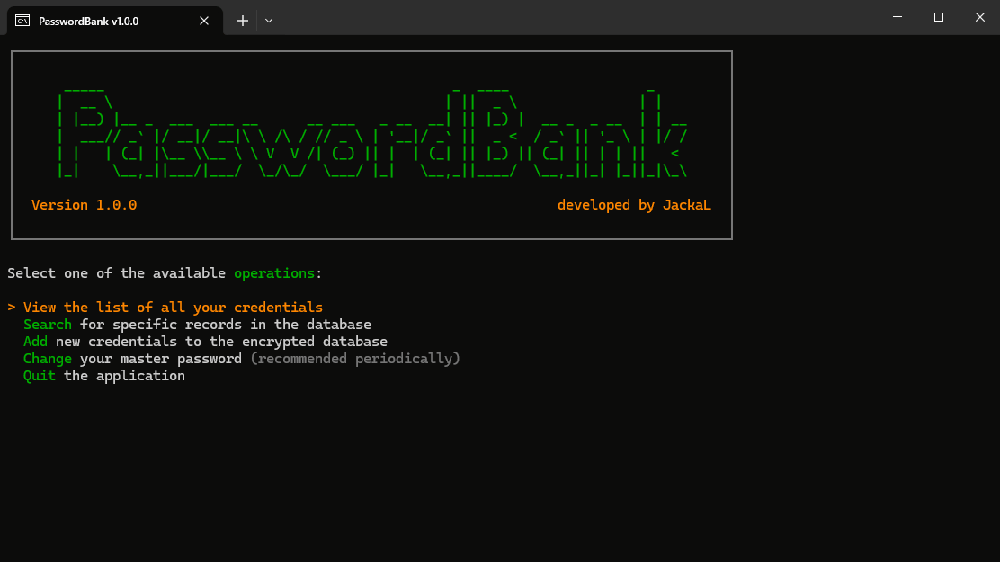

# PasswordBank


PasswordBank is a lightweight, offline password manager with an easy-to-use console interface. It is built on .NET, using [Spectre.Console](https://github.com/spectreconsole/spectre.console) for the terminal UI and [SQLite3 Multiple Ciphers](https://github.com/utelle/SQLite3MultipleCiphers) for the local encrypted database.



## Features

- ✔️ **Always offline:** Credentials are only stored locally and never leave your device.
- 🔒 **Two-layer encryption:** Uses *ChaCha20 / Poly1305* for full-database encryption and *AES-256-GCM* as additional encryption for sensitive data in-memory.
- 🔒 **Strong encryption key:** Uses 300,000 iterations of *PBKDF2-SHA-512* to generate the encryption key from the user-selected master password.
- 🔒 **Defense-in-depth:** Credentials stay always encrypted in memory and are decrypted just-in-time when required, plaintext secrets are wiped from memory as soon as they're not needed anymore.
- 🚀 **Portable:** No installation required, just run the *.exe* from anywhere (keep the database file alongside it).
- 🚀 **Lightweight:** The application package is < 8 MB, and has minimal hardware requirements.
- ✔️ **Easy-to-use:** Simple and intuitive console-based UI, supporting keyboard navigation.

## Supported platforms

*PasswordBank* should run on almost any platform that supports .NET 10:
- **Windows** (x86, x64 and ARM64)
- **Linux** (x64 and ARM64)
- **macOS** (x64 and ARM64)

Additionally, the terminal used to run *PasswordBank* must be **ANSI-capable** and support **alternate screen buffer**.
Other UI features (such as wide color-palette and Unicode support) can improve the experience but Spectre.Console has fallback implementations for those.

The following terminals have been tested and are certified for compatibility:
- 🖥️ **Windows Terminal** (cmd, PowerShell)
- 💻 **conhost** (cmd, Powershell)
- 📟 **mintty** (Cygwin, Git Bash, MSYS2)

## Installation and setup

The setup process is slightly different based on your operating system of choice.

> **NOTE:** On the first run, *PasswordBank* will create a `credentials.db` file in its folder.
> 
> This is the encrypted database where your credentials are stored: keep it alongside the application when moving it, and make secure backups of the database for recovery.

### Windows

Pre-built binaries are available for all supported Windows architectures on the [GitHub Releases page](https://github.com/pgallo725/passwordbank/releases):
1. Download the latest artifact for your architecture.
2. Extract the downloaded archive to your destination folder of choice.
3. Run the PasswordBank executable from its folder.

### Linux and macOS

These operating systems are supported, but pre-built binaries are not available so you should build the project yourself on the target system:

1. Install the [.NET 10 SDK](https://dotnet.microsoft.com/it-it/download/dotnet/10.0)
2. Open your terminal of choice and run the following commands:

```bash
# Clone the repository
git clone https://github.com/pgallo725/passwordbank.git

# Navigate to repository root
cd passwordbank

# Build the project (see notes below)
dotnet publish src/PasswordBank.csproj -p:PublishProfile=<publish-profile>

# Navigate to build output directory
cd bin/Publish/<target-platform>
```

## Contributions

*PasswordBank* is currently being **actively maintained**.

Please [open a GitHub issue](https://github.com/pgallo725/passwordbank/issues) to report any bug you might encounter using the application, suggest an improvement or request some new feature.
Contributions are also welcome — feel free to [open a pull request](https://github.com/pgallo725/passwordbank/pulls) with your changes.
